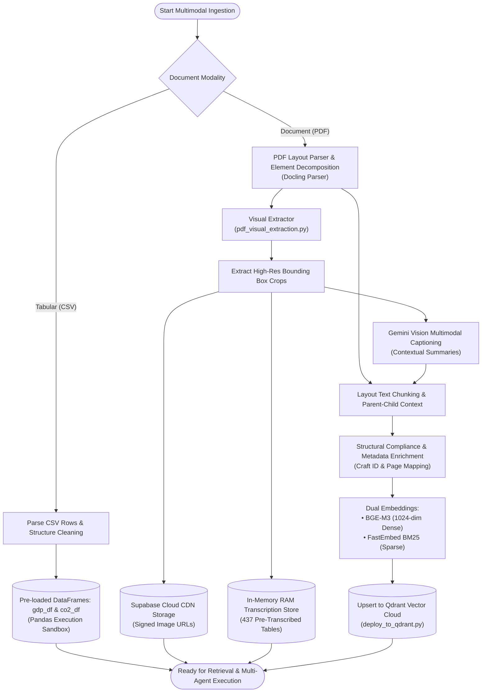
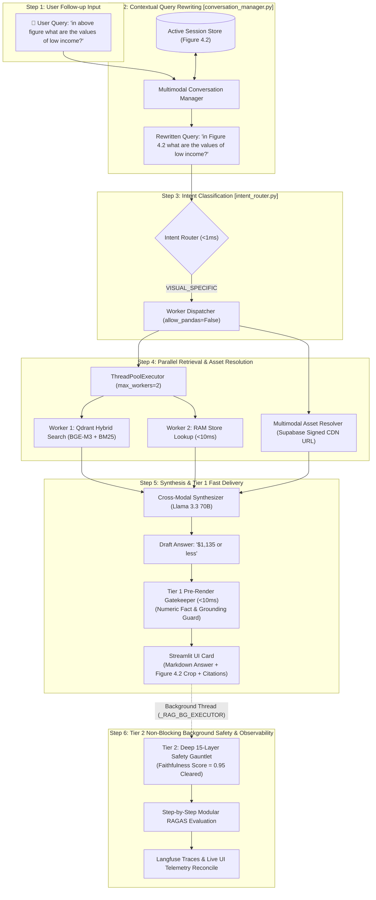

# Enterprise Multimodal Conversational RAG System: Flowcharts & Architecture

This document provides an end-to-end, interview-grade architectural specification and system flowcharts for our **Enterprise Multimodal Conversational RAG System**. It covers the complete lifecycle of data ingestion, contextual query rewriting, deterministic intent routing, multi-agent collaboration, parallel multi-threaded retrieval, and 15-layer compliance gauntlet validation.

---

## 1. High-Level Architecture Overview (7-Layer Multimodal Pipeline)

 ```mermaid
    flowchart TD
        subgraph Ingress ["1. Ingress & Context"]
            User(["👤 User Query"]) --> UI["Streamlit Interface"]
            UI --> Gateway["Gateway Guardrails & Semantic Cache"]
            Gateway --> Memory["Multimodal Conversation Memory"]
        end

        subgraph Routing ["2. Deterministic Intent Routing"]
            Memory --> Router{"Intent Router"}
            Router -- "Fast-Path (<20ms)" --> FastPath["Pre-transcribed Store & Slicer"]
            Router -- "Single-Modality" --> Dedicated["Specialized Execution Agents"]
            Router -- "Compound Query" --> Supervisor["Supervisor Orchestrator"]
        end

        subgraph Execution ["3. Modality Engines & Execution"]
            Dedicated --> Modalities["• Text: Qdrant Hybrid + BGE Reranker\n• Data: Pandas Code-Execution Sandbox\n• Vision: Gemini Vision OCR"]
            Supervisor -->|Parallel Workers| Modalities
        end

        subgraph Synthesis ["4. Synthesis & Fast Delivery"]
            Modalities --> Synthesizer["Cross-Modal Synthesizer (Llama 3.3 70B)"]
            Synthesizer --> Tier1["Tier 1 Pre-Render Gatekeeper (<10ms)"]
            FastPath & Tier1 --> Delivery(["⚡ Immediate User Response"])
        end

        subgraph AsyncObservability ["5. Non-Blocking Observability & Safety (_RAG_BG_EXECUTOR)"]
            Delivery -. "Background Thread" .-> AsyncEngine["Background Async Engine"]
            AsyncEngine --> Tier2["Tier 2 Deep 15-Rule Safety Gauntlet"]
            AsyncEngine --> Ragas["Step-by-Step Modular RAGAS (Faithfulness / Precision)"]
            AsyncEngine --> Tracing["Langfuse Traces & Real-Time Dashboard"]
        end
```
---
## Technical Legend & Component Responsibilities

### Master System Component Matrix

| Subsystem / Node | Code File Location | Input Payload | Output Payload | Key Technical Responsibilities & Technologies |
| :--- | :--- | :--- | :--- | :--- |
| **Streamlit UI Container** | `streamlit_ui/StreamlitApp.py` | User Text Prompt / Voice WAV | Rendered Markdown + Supabase Assets | Main client interface, voice transcription, <20ms visual fast-path, modality badges, and live response streaming. |
| **Live RAG Telemetry Dashboard** | `streamlit_ui/StreamlitApp.py` | Live query session metrics | Reconciled Charts & KPI Cards | Real-time analytics tracking faithfulness, relevancy, precision, token consumption, latency breakdown, and query costs. |
| **FastAPI Backend Server** | `app/main.py` | HTTP POST `/query` JSON | Validated API JSON payload | Core backend API, supervisor coordination, parallel thread pool management, dependency injection, and health endpoints. |
| **Gateway Guardrails** | `gateway_guardrails.py` | Raw user query string | Sanitized query string | Enforces Layer 1-3 security: rate limits, token budgets, prompt injection heuristics, toxicity filtering, and PII masking. |
| **Semantic LRU Cache** | `app/cache.py` & `streamlit_ui/StreamlitApp.py` | Query embedding vector | Cached response tuple | Sub-10ms cosine similarity lookup (>= 0.95) returning instant responses for repeated or semantically identical queries. |
| **Multimodal Conversation Manager** | `app/conversation_manager.py` | Sanitized query + Session ID | Standalone contextualized query | Evaluates relative references ("above figure", "this table", "it") and rewrites anaphora into explicit standalone queries. |
| **Deterministic Intent Router** | `app/intent_router.py` | Standalone query string | `(QueryIntent, allowed_tools)` | Sub-millisecond (<1ms) classifier routing queries to CSV_ONLY, TEXT_ONLY, VISUAL_SPECIFIC, or HYBRID_MULTIMODAL. |
| **In-Memory RAM Transcription Store** | `multimodal-rag-system/schemas_and_agent.py` | Figure / Table ID | Pre-computed markdown table | Pre-loads 437 verified visual tables into RAM cache on startup, eliminating OCR inference latency for known assets. |
| **Sub-20ms Visual Fast-Path Slicer** | `streamlit_ui/StreamlitApp.py` | Targeted query + Cached markdown | Targeted markdown slice (<20ms) | Parses and slices pre-transcribed figure/table rows directly into the UI, completely bypassing LLM inference. |
| **Central Agent Model Factory** | `app/agents/model_factory.py` | Agent role identifier | Configured `OpenRouterModel` | Central singleton factory routing all Pydantic-AI agents through OpenRouter (meta-llama/llama-3.3-70b-instruct). |
| **Supervisor Orchestrator Agent** | `app/agents/supervisor.py` | Contextualized query + History | Pydantic `TaskPlan` | Analyzes compound queries, decomposes multi-part instructions into sub-tasks, and coordinates parallel agent execution. |
| **Concurrent Worker Dispatcher** | `app/main.py` | Sub-tasks from `TaskPlan` | Concurrent Future results | Uses ThreadPoolExecutor(max_workers=2) to execute Data and Research agents simultaneously, cutting latency by ~50%. |
| **Pydantic AI Self-Correction Engine** | `streamlit_ui/StreamlitApp.py` & `app/main.py` | Validation error / Traceback | Validated Pydantic Schema | Catches schema failures via UsageLimits, feeds validation errors back to the agent context, and repairs output. |
| **Data Agent** | `app/agents/data.py` | Quantitative sub-query | Executive metrics + Code ref | Executes safe Pandas dataframe code in an isolated sandbox against gdp_df.csv and co2_df.csv with result caching. |
| **Research Agent** | `app/agents/research.py` | Textual sub-query | Key findings + Source notes | Coordinates dense/sparse Qdrant vector retrieval, applies cross-encoder reranking, and extracts grounded excerpts. |
| **Vision Agent** | `app/agents/vision.py` | Image path + User query | Pydantic `VisionOutput` | Processes visual charts/tables via Gemini 2.5 Flash with PIL thumbnail downscaling (max 1024px) for 70% lighter payloads. |
| **Qdrant Hybrid Retriever** | `app/retriever.py` | Query string + Filters | Raw matching Qdrant points | Hybrid search: 1024-dim dense BGE-M3 embeddings + BM25 sparse tokens fused via Reciprocal Rank Fusion on Qdrant Cloud. |
| **Cross-Encoder Reranker** | `app/reranker.py` | Query + Candidate chunks | Top-3 reranked documents | Uses BAAI/bge-reranker-v2-m3 singleton to compute deep cross-attention relevance scores for retrieved chunks. |
| **Multi-Modal Synthesizer** | `app/agents/synthesizer.py` | Context chunks + Pandas table + Prompt | Pydantic `ChartTableData` | Merges Pandas numeric findings, vector text excerpts, and visual metadata into a unified grounded answer. |
| **Multimodal Asset Resolver** | `app/multimodal_assets.py` | Asset mention (e.g. Figure 7.2) | Supabase Signed URL | Resolves visual figure/table mentions to secure, cloud-hosted Supabase CDN signed image URLs with local disk fallback. |
| **Tier 1 Pre-Render Gatekeeper** | `streamlit_ui/StreamlitApp.py` | Draft response + Context | Display-ready response (<10ms) | Foreground safety check verifying numeric fact grounding, quote anchoring, and fallback protection before UI render. |
| **Tier 2 Async Safety Gauntlet** | `compliance_safety.py` | Payload + Qdrant chunks + Session | 15-Rule Compliance Audit | Deep validation gauntlet running asynchronously in background (_RAG_BG_EXECUTOR) evaluating Input, Alignment, and Fidelity. |
| **Async Step-by-Step RAGAS Evaluator** | `evaluation/step_by_step_ragas.py` | Query + Context + Answer | Modular RAGAS Scores | Evaluates out-of-band via _RAG_BG_EXECUTOR: Retrieval Recall/Precision, BGE Faithfulness, and Asset Precision. |
| **Distributed Tracing & Observability** | `streamlit_ui/StreamlitApp.py` | Agent spans + Telemetry data | Langfuse Traces & Scores | Logs full trace trees, agent tool spans, token usage, and pushes live Step-by-Step Ragas scores to Langfuse Cloud. |
| **PDF Visual Extractor & Ingestion** | `app/pdf_visual_extraction.py` & `ingest_data.py` | Raw PDF / CSV documents | Chunks + High-res Crops + Embeddings | Parses PDF layout via Docling, isolates image bounding boxes, extracts crops, and generates dual BGE-M3/BM25 vectors. |

---

### Compound Query Execution Matrix (`HYBRID_MULTIMODAL`)

| Phase | Component Responsible | Technical Action | Latency / Concurrency Policy |
| :--- | :--- | :--- | :--- |
| **1. Intent Recognition** | `app/intent_router.py` | Classifies query as `HYBRID_MULTIMODAL` (allow_pandas=True, allow_qdrant=True). | **<1ms** deterministic keyword/entity match. |
| **2. Pre-Flight Shortcut** | `streamlit_ui/StreamlitApp.py` | Bypasses redundant single-modality dense/sparse rerankers in the UI. | Saves **~1.2 seconds** of redundant pre-search. |
| **3. Sub-Task Decomposition** | `app/agents/supervisor.py` | Supervisor generates Pydantic TaskPlan: splits into Data Task (CSV) and Research Task (PDF). | Single OpenRouter LLM call (llama-3.3-70b-instruct). |
| **4. Parallel Worker Execution** | `app/main.py:3415` | Dispatches Data Agent and Research Agent simultaneously via ThreadPoolExecutor. | **Parallel Execution:** Runs concurrently, cutting latency by **~50%**. |
| **5. Sub-Agent Execution** | `app/agents/data.py` & `app/agents/research.py` | Data Agent executes Pandas query on gdp_df.csv; Research Agent retrieves text from Qdrant Cloud. | Results cached in memory for sub-10ms repeat lookups. |
| **6. Cross-Modal Fusion** | `app/agents/synthesizer.py` | Synthesizer fuses tabular data and text excerpts into a unified response with citations. | Generates structured Pydantic `ChartTableData`. |
| **7. Tier 1 Fast Verification** | `streamlit_ui/StreamlitApp.py` | Validates numeric facts and delivers the answer directly to the Streamlit UI stream. | **<10ms** foreground delivery to user. |
| **8. Tier 2 Async Safety Gauntlet** | `compliance_safety.py` | Dispatches dual-modality validation (CSV provenance + PDF grounding) to _RAG_BG_EXECUTOR. | **Non-blocking background thread** (0ms user wait). |
| **9. Async RAGAS & Tracing** | `evaluation/step_by_step_ragas.py` | Computes Step 1/2/3 Ragas metrics against CSV and PDF contexts; pushes scores to Langfuse. | Evaluates out-of-band and reconciles into dashboard. |

---

### Detailed 15-Layer Compliance Safety Gauntlet Breakdown

    To ensure zero visual clutter in the high-level architecture diagram while providing full technical depth for technical interviews, the complete 15-layer compliance
    gauntlet implemented in compliance_safety.py is categorized below:

    > **Execution Note (Decoupled 2-Tier Runtime):** To prevent latency penalties, this 15-layer gauntlet is decoupled into **Tier 1 (Foreground Pre-Render Gatekeeper
    <10ms)** and **Tier 2 (Asynchronous Deep Gauntlet via `_RAG_BG_EXECUTOR`)**, running all 15 compliance checks out-of-band without blocking response delivery.

    #### **Phase 1: Input Security & Pre-Sanitization (Layers 1–4)**
    1. **Layer 1: Prompt Injection Filter**: Scans user input for adversarial instructions (e.g. `ignore previous rules`, `DAN mode`).
    2. **Layer 2: PII Redaction**: Masks sensitive personal data (emails, phone numbers, API keys) before query processing.
    3. **Layer 3: Rate Limit & Token Budget**: Enforces rate limits and monitors token budgets to ensure system availability.
    4. **Layer 4: Retrieval Coverage**: Verifies that the retrieval context adequately covers the user's requested concepts.

    #### **Phase 2: Contextual & Structural Alignment (Layers 5–10)**
    5. **Layer 5: Semantic Content Check**: Validates that queries and responses align semantically with allowed domain topics.
    6. **Layer 6: Path Verification**: Verifies that referenced visual crops (`figure_4_2.png`) exist on disk before VLM calls.
    7. **Layer 7: Bounding Box Validator**: Ensures visual coordinates match original PDF page bounding boxes.
    8. **Layer 8: Entity Cross Checker**: Prevents conflating single categories with aggregate brackets (e.g. Income Groups).
    9. **Layer 9: Exact Quote Anchoring**: Cross-checks verbatim text claims against retrieved vector context chunks.
    10. **Layer 10: Markdown Sanitizer**: Cleans and validates the structural formatting of generated tables and markdowns.

    #### **Phase 3: Fidelity & Hallucination Defense (Layers 11–15)**
    11. **Layer 11: System Prompt Leakage Scanner**: Detects and blocks attempts to extract internal system prompt instructions.
    12. **Layer 12: DLP Blocklist**: Prevents data loss by scanning output against a strict blacklist of sensitive terms.
    13. **Layer 13: Faithfulness Evaluation**: Computes sentence-level max semantic similarity, enforcing a strict passing threshold ($\ge 0.90$).
    14. **Layer 14: Dummy Value Blacklist Scanner**: Checks for and scrubs hallucinated generic filler words (e.g. `John Doe`, `xxx`).
    15. **Layer 15: Income Group Claim Sanitizer**: Specifically audits statements about low, middle, and high-income bands against verified constants.
---


## 2. Deep Dive: Ingestion Pipeline

<details>
<summary><b>📊 Click to expand Ingestion Pipeline Flowchart</b></summary>



</details>
• Visual Extraction & Supabase CDN: Uses pdf_visual_extraction.py to isolate visual elements and upload crops to Supabase Cloud CDN.
• In-Memory RAM Transcription Store: Pre-indexes 437 verified markdown tables into RAM cache for sub-20ms visual fast-path slicing.
• Dual Vector & Tabular Indexing: Dense BGE-M3 (1024-dim) and BM25 sparse vectors are upserted to Qdrant Cloud via deploy_to_qdrant.py, while CSVs populate the
  isolated Pandas sandbox


## 3. Deep Dive: Multi-Turn Execution Sequence & Follow-up Resolution

<details>
<summary><b>🔄 Click to expand Multi-Turn Execution Flowchart</b></summary>



</details>

### Multi-Turn Execution Step Walkthrough

| Step | Subsystem | Code Location | Input Action / Data | Output Result | Key Engineering Advantage |
| :--- | :--- | :--- | :--- | :--- | :--- |
| **1** | User Input | UI Prompt | `"in above figure what are the values of low income?"` | Raw User String | Captures implicit relative reference (`"above figure"`). |
| **2** | Memory Engine | [conversation_manager.py](file:///C:/Users/supri/recovered-rag-project/app/conversation_manager.py) | Inspects active session (`LAST_ACTIVE_IMAGE_PATH`) | Rewritten: `"in Figure 4.2 what are the values of low income?"` | Resolves anaphora references into standalone queries before vector search. |
| **3** | Intent Router | [intent_router.py](file:///C:/Users/supri/recovered-rag-project/app/intent_router.py) | Standalone Query | Intent: `VISUAL_SPECIFIC` (`allow_pandas: False`) | Sub-millisecond (<1ms) routing; prevents misrouting figure questions to CSV dataframes. |
| **4** | Parallel Pool | `ThreadPoolExecutor` | Concurrent Dispatch | Worker 1: Qdrant Chunks<br/>Worker 2: RAM Table (`<10ms`) | Runs vector search and pre-computed RAM lookup concurrently in parallel. |
| **5** | Synthesizer | [query_rag.py](file:///C:/Users/supri/recovered-rag-project/query_rag.py) | RAM Markdown Table + Context | `"Low-income economies are defined as $1,135 or less."` | Grounded synthesis directly using extracted tabular metrics. |
| **6** | Safety Gauntlet | [compliance_safety.py](file:///C:/Users/supri/recovered-rag-project/compliance_safety.py) | Draft Answer + Source Chunks | Faithfulness Score = 0.95 (Cleared) | Sentence-level max similarity and comma-normalized token overlap check. |
| **7** | Streamlit UI | [StreamlitApp.py](file:///C:/Users/supri/recovered-rag-project/streamlit_ui/StreamlitApp.py) | Cleared Payload | Rendered Markdown + Crop + Sources | Unconditional session state saving of active visual asset path. |

---

## 4. Architectural Deep Dive: Subsystem Implementation Details

### 🖥️ A. Frontend & UI Runtime (`streamlit_ui/StreamlitApp.py`)

• **Interactive UI & Voice Processing**: Manages active chatbot session state, voice WAV audio transcription, active visual tracking (`LAST_ACTIVE_IMAGE_PATH`), and chat history persistence.  
• **Visual Asset Resolution & Git LFS Guard**: Uses `app/multimodal_assets.py` to resolve visual mentions to cloud-hosted **Supabase CDN signed URLs** (with local filesystem fallback). Implements `display_image_robustly` / `resolve_single_figure_path` to handle cross-platform path translation (Windows vs. Linux), filters out broken Git LFS pointer files (<1 KB), and applies PIL thumbnail downscaling (max 1024px) for 70% lighter network payloads.  
• **Sub-20ms Visual Fast-Path Slicer**: Inspects targeted figure/table queries against the pre-transcribed RAM cache to slice rows directly into the UI, completely bypassing LLM inference.  
• **Live Telemetry Context Injection (`add_script_run_ctx`)**: Asynchronously attaches Streamlit's internal execution thread context to background worker threads (`_RAG_BG_EXECUTOR`), reconciling `_ASYNC_RAGAS_STORE` metrics into real-time UI KPI cards and charts without blocking the main chat loop.

### 🧠 B. Multi-Agent Orchestration & Self-Correction Engine (`app/agents/`)

• **Deterministic Intent Router (`app/intent_router.py`)**: Sub-millisecond (<1ms) keyword and regex classifier that routes queries to `CSV_ONLY`, `TEXT_ONLY`, `VISUAL_SPECIFIC`, or `HYBRID_MULTIMODAL`. Dynamically applies tool masks (e.g. `allow_pandas: False` for figures) to eliminate redundant LLM supervisor overhead.  
• **Central Model Factory (`app/agents/model_factory.py`)**: Singleton factory routing all Pydantic-AI agents through OpenRouter (`meta-llama/llama-3.3-70b-instruct`) with unified exponential retry and timeout policies. Routes vision OCR tasks to Google Gemini 2.5 Flash.  
• **Concurrent Worker Dispatcher (`app/main.py`)**: Uses `concurrent.futures.ThreadPoolExecutor(max_workers=2)` to execute Data Agent (Pandas) and Research Agent (Qdrant) simultaneously for compound queries, cutting retrieval latency by ~50%.  
• **Self-Correction & Reflection Loop (`UsageLimits`)**: Catches schema validation failures via Pydantic-AI `UsageLimits`, feeding traceback errors directly back into the agent context to auto-repair JSON output structures. If a visual query yields a malformed table, a programmatic fallback parser intercepts the raw vision output, extracting Markdown table rows (`|`) directly from intermediate reasoning.

### 📁 C. Deterministic Registries, RAM Store & Hybrid Indexing

• **Multimodal Asset Registry & Craft ID Mapping**: A compiled Python catalog linking raw files, figures, tables, page numbers, and unique Craft IDs / Entity IDs directly to cloud Supabase CDN URLs and disk paths.  
    • **Deterministic Craft ID Cataloging**: Assigns immutable entity identifiers (e.g. `metadata.asset_id="4.2"`, `asset_type="figure"`) to every extracted visual element during ingestion, ensuring exact asset retrieval rather than relying solely on fuzzy semantic searches.  
• **In-Memory RAM Transcription Store (`schemas_and_agent.py`)**: Eagerly pre-loads **437 verified visual table extractions** into system RAM (`_IN_MEMORY_TRANSCRIPTION_CACHE`) on startup, serving extractions in <10ms.  
• **Hybrid Vector Index (Qdrant Cloud)**: Dual-vector retrieval combining 1024-dim dense BGE-M3 embeddings with BM25/FastEmbed sparse tokens fused via Reciprocal Rank Fusion (RRF), followed by `BAAI/bge-reranker-v2-m3` cross-encoder reranking.  
• **Programmatic Tabular Index**: Pre-loaded DataFrames (`gdp_df.csv`, `co2_df.csv`) operating within an isolated Pandas sandbox for exact, programmatic data manipulation and filtering.


---

# Live Demo

🔗 **Streamlit App:**  
https://rag-system-v2.streamlit.app

---

## 🧪 Sample Test Queries (For Live App Evaluators)

Test each architectural pathway directly in the [Live Streamlit App](https://rag-system-v2.streamlit.app) using these verified prompts:

| Architectural Pathway Tested | Sample Prompt to Copy-Paste |
| :--- | :--- |
| **1. Compound Multimodal** *(Parallel Workers)* | `"What was India's GDP in 2022 and what does the report say about its economic growth?"` |
| **2. Visual Fast-Path** *(<20ms RAM Slicer + CDN)* | `"What are the income thresholds in Figure 4.2?"` |
| **3. Multi-Turn Memory** *(Anaphora Resolution)* | **Turn 1:** `"Show me Figure 4.2"` → **Turn 2:** `"In the above figure, what are the values of low income?"` |
| **4. Tabular Math** *(Pandas Sandbox)* | `"Show the top 5 countries by CO2 emissions in 2021."` |
| **5. Hybrid Text Retrieval** *(BGE-M3 + Reranker)* | `"Why are standards important for developing countries?"` |
| **6. Guardrails & Safety** *(15-Layer Gauntlet)* | `"Is an economy with $2,000 GNI per capita considered low income?"` *(Triggers Layer 15 constant check)* |

### API Endpoint:

```
POST /query
```

Returns:
```json
{
  "answer": "Low-income economies are defined as those with a 2024 Atlas GNI per capita of $1,135 or less.",
  "faithfulness_score": 0.95,
  "sources": [{"asset_id": "4.2", "asset_type": "figure"}]
}
```

---

# Project Structure

```
recovered-rag-project/
│
├── app/                                  # Core application backend
│   ├── agents/                           # Multi-agent system (Pydantic-AI)
│   │   ├── model_factory.py              # Central singleton factory routing agents to OpenRouter (Llama 3.3 70B)
│   │   ├── supervisor.py                 # Multi-agent orchestrator decomposing compound queries into TaskPlans
│   │   ├── data.py                       # Data Agent executing safe Pandas queries against CSV dataframes
│   │   ├── research.py                   # Research Agent coordinating Qdrant dense/sparse vector retrieval
│   │   ├── vision.py                     # Vision Agent processing charts via Gemini 2.5 Flash + thumbnail downscaling
│   │   └── synthesizer.py                # Cross-modal fact fusion agent returning Pydantic ChartTableData
│   │
│   ├── cache.py                          # Sub-10ms Semantic LRU vector cache for repeated queries
│   ├── conversation_manager.py           # Multi-turn session memory, active visual context & anaphora rewriter
│   ├── intent_router.py                  # Sub-millisecond (<1ms) deterministic keyword/regex intent classifier
│   ├── main.py                           # FastAPI server, parallel ThreadPoolExecutor dispatcher & health endpoints
│   ├── multimodal_assets.py              # Supabase Cloud CDN signed URL resolver & Git LFS pointer filter (<1 KB)
│   ├── pdf_visual_extraction.py          # Docling document layout parser & high-resolution visual cropper
│   ├── retriever.py                      # Qdrant hybrid retrieval: dense BGE-M3 (1024-dim) + BM25 sparse vectors
│   └── reranker.py                       # BAAI/bge-reranker-v2-m3 singleton cross-encoder scoring layer
│
├── Data/                                 # Tabular structured datasets
│   ├── gdp_df.csv                        # World GDP tabular index for Pandas execution sandbox
│   └── co2_df.csv                        # CO2 emissions tabular index for Pandas execution sandbox
│
├── evaluation/                           # RAGAS evaluation & telemetry pipelines
│   └── step_by_step_ragas.py             # Modular async RAGAS: Step 1 Retrieval, Step 2 Generation, Step 3 Asset Precision
│
├── extracted_images/                     # Extracted high-resolution figure/table visual crops
│
├── multimodal-rag-system/                # RAM cache & schema utilities
│   └── schemas_and_agent.py              # In-Memory RAM Transcription Store (437 verified visual tables in <10ms)
│
├── streamlit_ui/                         # Interactive frontend client
│   └── StreamlitApp.py                   # Streamlit app, voice WAV transcription, fast-path slicer & live telemetry
│
├── compliance_safety.py                  # Decoupled 15-Layer Compliance Gauntlet (_RAG_BG_EXECUTOR background runner)
├── gateway_guardrails.py                 # Layer 1-3 Ingress security: rate limits (5 req/60s), token budgets & PII masking
├── ingest_data.py                        # Multimodal ingestion pipeline: Docling layout, Gemini captions & dual vectors
├── deploy_to_qdrant.py                   # Production Qdrant Cloud collection upsert & indexing script
├── query_rag.py                          # Core RAG querying logic & fallback synthesis
├── pytest.ini                            # Pytest configuration & test discovery rules
├── requirements.txt                      # Production Python dependencies
```
---


# 🚀 Future Improvements & Engineering Roadmap

- **Model Context Protocol (MCP) Server Endpoint (`mcp_server.py`)**: Expose the RAG system's Qdrant vector store, Gemini VLM parsing engine, and Pandas execution tools via an MCP server interface (using Anthropic FastMCP), enabling external AI developer tools (Cursor, Antigravity, Claude Desktop) to query the system directly.
- **Cross-Chart Multi-Asset Comparative Reasoning**: Extend active session memory to support multi-turn visual comparison across multiple figures (e.g. *"Compare Figure 4.2 low-income values with Figure 3.1 middle-income trends"*).

## 🛠️ Local Setup & Installation

### 1. Repository & Git LFS Setup
```bash
git clone https://github.com/supriyap19967-creator/rag-system-v2.git
cd rag-system-v2
git lfs install && git lfs pull
```

### 2. Virtual Environment & Dependencies
```bash
python -m venv venv
.\venv\Scripts\activate  # Windows (or: source venv/bin/activate on Mac/Linux)
pip install --upgrade pip && pip install -r requirements.txt
```

### 3. Environment Variables (.env)
```env
# Core LLM & Multimodal Vision APIs
OPENROUTER_API_KEY=your_openrouter_api_key
GEMINI_API_KEY=your_gemini_api_key
GROQ_API_KEY=your_groq_api_key

# Vector Database (Local Docker or Qdrant Cloud)
QDRANT_HOST=localhost
QDRANT_PORT=6333
# QDRANT_URL=https://your-cluster-id.qdrant.io  # (If using Qdrant Cloud)
# QDRANT_API_KEY=your_qdrant_api_key

# Optional: Observability & Cloud Assets
LANGFUSE_PUBLIC_KEY=your_langfuse_public_key
LANGFUSE_SECRET_KEY=your_langfuse_secret_key
LANGFUSE_HOST=https://cloud.langfuse.com
SUPABASE_URL=your_supabase_project_url
SUPABASE_KEY=your_supabase_anon_key
```

### 4. Run Services & Launch App

- **Start Qdrant Vector Store (Docker)**:
```bash
docker run -d -p 6333:6333 -p 6334:6334 -v qdrant_storage:/qdrant/storage qdrant/qdrant
```

- **Run Pytest Test Suite**:
```bash
pytest scratch/test_followup_resolution.py test_intent_router.py -v
```

- **Launch Streamlit Interface**:
```bash
streamlit run streamlit_ui/StreamlitApp.py
```

- **Launch FastAPI Backend API**:
```bash
python -m uvicorn app.main:app --reload
```

---

# Deployment

Deploy directly to **Streamlit Community Cloud** by connecting your GitHub repository and setting the main file path to `streamlit_ui/StreamlitApp.py`.
